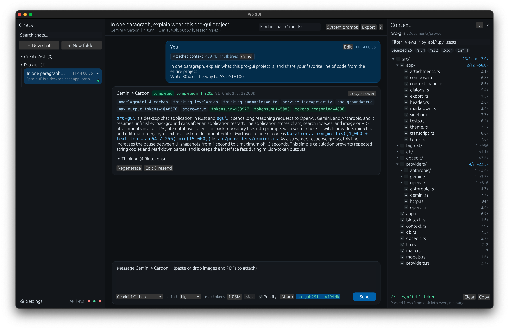

<p align="center"><a href="README.md">EN</a></p>

# Pro GUI

Pro GUI es mi cliente de escritorio personal para modelos de lenguaje, escrito en Rust. Lo creé para usar [o1 pro](https://developers.openai.com/api/docs/models/o1-pro) de OpenAI, un modelo que puede pensar varios minutos antes de responder. Con el tiempo lo fui ampliando a otros modelos que se toman su tiempo en lugar de devolver una respuesta rápida en streaming, y cuyos proveedores permiten ejecutar peticiones en segundo plano: [background mode de OpenAI](https://developers.openai.com/api/docs/guides/background) y [background execution de Gemini](https://aistudio.google.com/docs/background-execution).

Funciona solo con tus propias API keys. Los chats, la configuración y las keys se guardan en una base de datos SQLite local, y nada sale de tu equipo salvo las peticiones al proveedor que elijas.

<p align="center"></p>

## Características

* Modelos de OpenAI, Google Gemini y Anthropic, además de cualquier ID de modelo que escribas.
* Ejecución en segundo plano con OpenAI y Gemini: la respuesta sigue generándose aunque cierres la app, se recupera al volver a abrirla y en macOS recibes una notificación cuando termina.
* Modelo, esfuerzo de razonamiento, límite de salida y procesamiento prioritario configurables en cada mensaje.
* Carpetas para agrupar chats, búsqueda entre todos ellos y búsqueda dentro del chat abierto.
* Conteo de tokens por chat, separado en entrada, salida y razonamiento.
* Respuestas en Markdown con bloques de código y LaTeX, con el resumen del razonamiento del modelo aparte.
* Un panel lateral para elegir archivos de un proyecto en pocos clics, con filtros por nombre, patrón o extensión. Los archivos seleccionados se leen del disco y se envían con cada mensaje, y si nunca abres el panel no te estorba.
* Adjuntos de imágenes y PDF, edición y reenvío de mensajes anteriores, y exportación a Markdown o JSON.

## Primeros pasos

Necesitas Rust 1.88 o superior, que puedes instalar con [rustup](https://rustup.rs).

```sh
git clone https://github.com/zubus/pro-gui.git
cd pro-gui
cargo run --release
```

Con la ventana abierta:

1. Abre Settings con Cmd+, y elige Manage API keys.
2. Pega una key por cada proveedor que vayas a usar. Con una basta.
3. Elige un modelo debajo del cuadro de mensaje, escribe tu prompt y envíalo con Cmd+Enter.
4. Para incluir código de un proyecto, pulsa Cmd+E, elige la carpeta y marca los archivos que quieras.

En Linux, usa Ctrl donde esta guía dice Cmd. Cmd+/ muestra todos los atajos.

## Tus datos

Todo se guarda en un único archivo SQLite:

```
macOS   ~/Library/Application Support/Pro GUI/pro_gui.sqlite3
Linux   ~/.local/share/pro-gui/pro_gui.sqlite3
```

Las API keys se guardan ahí en texto plano, así que mantén el archivo privado. Las exportaciones y copias de seguridad de la base de datos se guardan en tu carpeta de Descargas.
