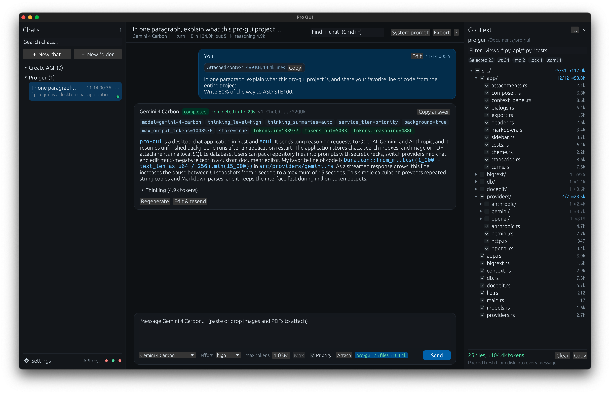

<p align="center"><a href="README.es.md">ES</a></p>

# Pro GUI

Pro GUI is my personal desktop client for large language models, written in Rust. I first built it to use OpenAI's [o1 pro](https://developers.openai.com/api/docs/models/o1-pro), a model that can think for many minutes before it replies. Over time it grew to cover other models that take their time instead of streaming a quick answer, and whose providers can run requests in the background: [OpenAI background mode](https://developers.openai.com/api/docs/guides/background) and [Gemini background execution](https://aistudio.google.com/docs/background-execution).

It works only with your own API keys. Chats, settings and keys stay in a local SQLite database, and nothing leaves your machine except the requests sent to the provider you choose.

<p align="center"></p>

## Features

* Models from OpenAI, Google Gemini and Anthropic, plus any model ID you type in.
* Background runs on OpenAI and Gemini: a reply keeps going if you quit, the app picks it up when you reopen it, and macOS shows a notification when it finishes.
* Model, reasoning effort, output limit and priority processing can change with every message.
* Folders to group chats, search across all of them, and find within the open one.
* Token totals for each chat, split into input, output and reasoning.
* Answers rendered as Markdown with code blocks and LaTeX, with the model's reasoning summary kept apart.
* A side panel to pick files from a project in a few clicks, filtered by name, pattern or extension. The selected files are read from disk and sent with each message, and the panel stays out of the way if you never open it.
* Image and PDF attachments, editing and resending earlier messages, and export to Markdown or JSON.

## Getting started

You need Rust 1.85 or newer, which you can install with [rustup](https://rustup.rs).

```sh
git clone https://github.com/zubus/pro-gui.git
cd pro-gui
cargo run --release
```

Once the window opens:

1. Open Settings with Cmd+, and choose Manage API keys.
2. Paste a key for each provider you plan to use. One is enough.
3. Pick a model below the message box, write your prompt and send it with Cmd+Enter.
4. To include code from a project, press Cmd+E, choose the folder and tick the files you want.

On Linux, use Ctrl wherever this guide says Cmd. Cmd+/ lists every shortcut.

## Your data

Everything lives in a single SQLite file:

```
macOS   ~/Library/Application Support/Pro GUI/pro_gui.sqlite3
Linux   ~/.local/share/pro-gui/pro_gui.sqlite3
```

API keys are stored there in plain text, so keep the file private. Exports and database backups are saved to your Downloads folder.
